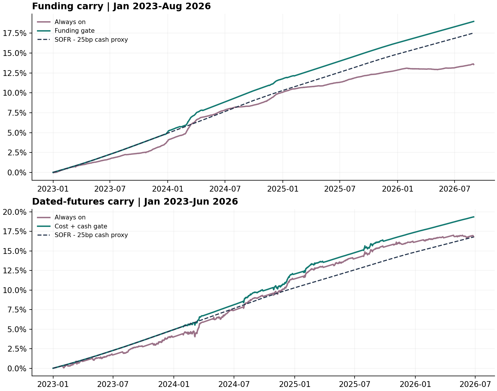

# BTC/ETH Spot-Futures Carry Research

**Can a futures premium pay for execution costs, tied-up capital and the return available on cash?**

I built a cost-aware backtest of buying BTC/ETH spot and shorting dated inverse futures, and compared a fixed entry filter with trading every eligible contract. A separate experiment studies funding payments on linear perpetual futures. The repository keeps the two mechanisms, accounts and result periods distinct.

**Headline:** over January 2023–26 June 2026, the filtered dated-futures strategy returned **19.35% net**, versus **16.81%** for always-on and **16.79%** for the cash proxy. Trading costs fell **66.8%**. The annualised Sharpe of daily returns above cash was **0.93**, with **0.68% maximum drawdown sampled on hourly NAV**.

These are retrospective research simulations with assumed costs. Total returns include interest on unused cash; most of the total return is cash interest. The study is evidence of accounting, execution modelling and validation, rather than a live trading record.

[Technical walkthrough](relative_value/README.md) · [Research report](relative_value/deliverables/Quant_Relative_Value_Research.pdf) · [Results evidence map](relative_value/RESULTS.md) · [Final tables](relative_value/deliverables/Final_Results.csv) · [Risk metric definitions](relative_value/docs/CV_RISK_METRICS.md)



## Results at a glance

Dated-futures evaluation: 1 January 2023–26 June 2026, base assumed one-way costs of 12 basis points for spot and 7 for futures.

| Metric | Fixed cost-and-cash filter | Always-on | Cash proxy |
|---|---:|---:|---:|
| Net cumulative return | 19.35% | 16.81% | 16.79% |
| Annualised compounded return | 5.20% | 4.55% | 4.55% |
| Annualised daily cash-excess Sharpe | 0.93 | 0.01 | Not applicable |
| Maximum drawdown on daily-close NAV | 0.37% | 0.69% | See benchmark series |
| Trading costs in the evaluation | $1,653.90 | $4,975.44 | Not modelled |

The filtered strategy's **hourly-NAV drawdown is 0.68%**, larger than its daily-close drawdown. It is a peak-to-trough loss over the evaluation, not a maximum one-hour loss. Sharpe uses **daily excess returns with 365-day annualisation**, not hourly returns.

The filter adds about **2.57 percentage points of cumulative return above cash**, not 19.35 percentage points. At the highest cost stress (30/20 basis points per leg per side), its cumulative return is 16.79%, effectively matching cash. See [all cost scenarios](relative_value/reports/inverse_summary.csv) and [dependence-aware inference](relative_value/reports/dependence_diagnostics.json).

## What the strategy does

1. Consider all 44 BTC/ETH quarterly futures from 2021Q1 through 2026Q2.
2. Observe the completed-hour futures premium 60 days before expiry.
3. Trade only when the premium exceeds round-trip base costs, cash opportunity cost and a fixed 2% annual risk buffer.
4. Buy spot and short integer-sized, coin-collateralised inverse futures, with matched coin collateral after entry fees.
5. Enter and unwind in 24 hourly slices, subject to each leg's 1% limit based on the previous 24 hours' average hourly notional volume.
6. Keep rejected or unfilled allocations in cash, record fees and coin dust explicitly, and mark the account hourly.

The supported prototype starts with **$100,000 in January 2021**. Its NAV entering the 2023 evaluation is **$108,787.58**. An earlier $1 million simulation failed an unwind-capacity check; that failure is retained. Neither starting capital is evidence of live AUM or a proven capacity limit.

The [technical README](relative_value/README.md) derives the inverse-contract hedge and explains the signal timestamps, sizing, cash ledger, collateral, cost stresses and separate funding experiment.

## Funding carry versus dated-futures carry

| Research branch | Return mechanism | Main implementation |
|---|---|---|
| Dated BTC/ETH inverse futures — headline study | Futures/spot basis convergence, plus interest on free cash | [inverse.py](relative_value/inverse.py) |
| BTC/ETH linear perpetual funding — supporting study | Funding receipts/payments, basis movements, costs and cash interest | [carry.py](relative_value/carry.py) |
| Earlier BTC-only feasibility study | Historical funding and cash-ledger investigation | [Earlier study guide](docs/EARLIER_FUNDING_STUDY.md) |

The repository name is historical. **The 19.35% return, 0.93 Sharpe and 0.68% hourly drawdown belong to the dated-futures study**, not the perpetual-funding experiment. Dated futures do not receive the periodic funding payments modelled in the perpetual branch.

## Reproduce from a clean checkout

Use Python 3.11 or newer, a terminal and the pinned dependencies. No exchange account or API credentials are needed.

```bash
git clone https://github.com/Fakhruddin12/btc-funding-carry.git
cd btc-funding-carry/relative_value
python -m venv .venv
# macOS/Linux:
source .venv/bin/activate
# Windows PowerShell instead: .venv\Scripts\Activate.ps1
python -m pip install -r requirements.txt

python extract_inputs.py
python verify_inputs.py
python -m pytest -q tests

# Reproduce dated-futures results and the CV risk metrics:
python inverse.py
python cv_metrics.py
```

The data are supplied as **19 checked archive parts**, containing **139 processed input files**. Extraction verifies the parts, reassembled archive and ZIP integrity; the input verifier checks file sizes and SHA-256 hashes. The backtest regenerates large hourly ledgers that are intentionally excluded from Git. Runtime depends on the machine and includes all six model/cost combinations.

For the funding experiment, diagnostics and report-generation commands, see [the full reproduction guide](relative_value/README.md#reproduction-workflows). Plot/report dependencies are included in the pinned environment.

## Where to look in the repository

| Path | Purpose |
|---|---|
| [relative_value/](relative_value/) | Current study, implementation, protocols, input snapshot and results |
| [relative_value/inputs/](relative_value/inputs/) | Split frozen input archive and part hashes |
| [relative_value/tests/](relative_value/tests/) | 31 tests of accounting, execution timing, sizing and model behaviour |
| [relative_value/reports/](relative_value/reports/) | Summaries, orders, episode decisions, audits and uncertainty estimates |
| [relative_value/deliverables/](relative_value/deliverables/) | PDF, readable research report, figures and final CSV |
| [relative_value/trial_ledger.csv](relative_value/trial_ledger.csv) | Record of research branches and selection history |
| [relative_value/docs/PUBLICATION_CHECKS.json](relative_value/docs/PUBLICATION_CHECKS.json) | Earlier publication verification record |
| [docs/EARLIER_FUNDING_STUDY.md](docs/EARLIER_FUNDING_STUDY.md) | Guide to the historical root-level funding study |
| [RIGHTS.md](RIGHTS.md) | Code and data rights information |

## Verification

[The 27 October verification record](relative_value/docs/VERIFICATION_2026-10-27.md) records a fresh clean-checkout input verification, 31 passing tests and an exact replay of all six dated-futures cases and CV risk metrics. The separate funding branch was inspected but not rerun in that check. The root-level `file_manifest.json` belongs to the earlier research release; use `relative_value/INPUT_SNAPSHOT.json` to verify the current processed inputs.

## Evaluation and limitations

Signals use completed information, capacity uses lagged volume and forecast training purges unfinished labels. However, preliminary later-period results were seen before uniform accounting and execution corrections. The final study is a **retrospective chronological evaluation**, not an untouched prospective holdout.

The main execution and risk assumptions are material:

- Hourly opens and all-in cost assumptions do not reconstruct bid/ask quotes, queue position, partial-fill uncertainty or asynchronous fills across legs.
- A 1% participation limit is a constraint, not proof of available order-book liquidity or a market-impact estimate.
- Interest on unused cash is a proxy based on seven-day-lagged SOFR minus 25 basis points, floored at zero. It is not an investable USDT deposit rate.
- Coin custody, exchange default, stablecoin depeg, ADL, transfer delays, taxes and operational failures are not reconstructed.
- Collateral checks use observed OHLC/mark information and do not certify liquidation safety under all intrahour paths.
- Conventional Sharpe and drawdown can understate rare risks in convergence strategies. The report includes block-bootstrap and dependence-adjusted diagnostics.

No script in this repository places live orders. The findings support a modest, cost-sensitive carry result under stated assumptions, not guaranteed returns or persistent alpha.

**Author:** Fakhruddin Hakim Hussain · [GitHub](https://github.com/Fakhruddin12)
